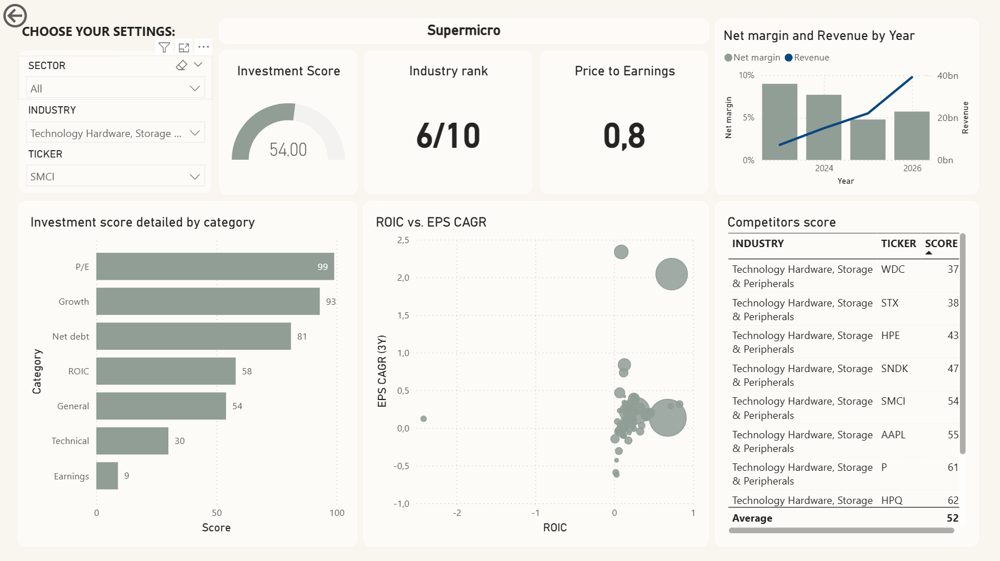

<div align="center">

🇫🇷 **[Version française](#version-française)** · 🇬🇧 **[English version](#english-version)**

</div>

---

<p align="center">
  
  
  
  
  
  
</p>

<div align="center">

🇫🇷 **Version française**

</div>

<a id="version-française"></a>

# 📈 S&P 500 : moteur de scoring d'investissement et analyse des entreprises

<p align="center">
  <strong>Transformer les données financières brutes en un score d'investissement fiable, comparable et exploitable — de l'extraction à l'aide à la décision.</strong>
</p>

> ⚠️ **Avertissement** : ce projet est un exercice d'analytics engineering à but éducatif et démonstratif. Il ne constitue **pas un conseil en investissement** et ne doit pas être utilisé comme base pour des décisions d'investissement réelles. Aucune garantie n'est donnée sur l'exactitude ou la complétude des données.

  

## 🎯 Contexte & objectif

Évaluer ~500 entreprises cotées à la main n'est ni fiable ni reproductible : chaque investisseur regarde quelques ratios isolés, sans cadre de comparaison homogène au sein d'une même industrie.

Ce projet construit un **pipeline d'analytics engineering de bout en bout** qui :

- **Collecte** les données fondamentales, boursières et d'estimations analystes des ~500 sociétés du S&P 500.
- **Industrialise** les transformations avec dbt dans Snowflake, suivant une architecture en médaillon : nettoyage, KPIs normalisés par industrie, scoring.
- **Restitue** un **score d'investissement (0–100)** par entreprise, décliné par catégorie, via un tableau de bord Power BI interactif.

Objectif métier : répondre à *« où se situe cette entreprise par rapport à ses pairs, et sur quels leviers est-elle sous- ou sur-évaluée ? »*

## ⚡ Résultats clés

Un score d'investissement unique sur 100 pour évaluer, comparer et classer les entreprises du S&P 500 selon leur valorisation, leur momentum, leur solidité financière, leur rentabilité et leur croissance.

- **Scoring multi-facteurs** : agrégation de KPIs financiers et techniques via des percentiles pondérés.
- **Comparabilité sectorielle** : valorisations normalisées par rapport à la médiane de chaque industrie.
- **Aide à la décision** : score global et décomposition par catégorie pour identifier les forces et faiblesses de chaque entreprise.

## 🧰 Stack technique

| Catégorie | Technologie | Rôle |
|---|---|---|
| Langage | **Python** (pandas, yfinance) | Collecte des données : scrape Wikipedia + API Yahoo Finance |
| Stockage brut | **AWS S3** | Zone de landing des fichiers CSV |
| Entrepôt de données | **Snowflake** | Environnement analytique (staging → transformations) |
| Transformation | **dbt** (Fusion) | Modélisation SQL, tests, documentation |
| BI / visualisation | **Power BI** | Tableau de bord interactif de scoring |
| Contrôle de version | **Git / GitHub** | Gestion du code source et documentation |

## 🏗️ Architecture du pipeline

```text
WIKIPEDIA (S&P 500)   YAHOO FINANCE API
        │                    │
        ▼                    ▼
┌─────────────────────────────────────┐
│ EXTRACT · Scripts Python            │
│ companies.csv + 7 jeux de données   │
│ (income, balance, cashflow, prices, │
│  metrics, EPS TTM, estimations)     │
└──────────────────┬──────────────────┘
                   ▼
┌─────────────────────────────────────┐
│ LOAD · AWS S3 → Snowflake STAGING   │
│ COPY INTO depuis un stage S3        │
└──────────────────┬──────────────────┘
                   ▼
┌─────────────────────────────────────┐
│ BRONZE · dbt staging : 8 modèles    │
│ Standardisation des données brutes  │
└──────────────────┬──────────────────┘
                   ▼
┌─────────────────────────────────────┐
│ SILVER · dbt intermediate : 3       │
│   - int_kpis    : ratios financiers │
│   - int_score   : scoring 0–100     │
│   - int_trend   : SMA 50 semaines    │
└──────────────────┬──────────────────┘
                   ▼
┌─────────────────────────────────────┐
│ GOLD · dbt marts : 4 modèles        │
│ score · score_detailed · peers ·    │
│ financials                          │
└──────────────────┬──────────────────┘
                   ▼
┌─────────────────────────────────────┐
│ POWER BI · Dashboard interactif     │
└─────────────────────────────────────┘
```

### Décomposition dbt (architecture en médaillon)

| Médaillon | Couche dbt | Modèles | Rôle |
|---|---|---|---|
| 🥉 Bronze | `staging` | **8** | Standardisation et typage des sources brutes Snowflake |
| 🥈 Silver | `intermediate` | **3** | Calcul des KPIs, normalisation par industrie, scoring, tendance |
| 🥇 Gold | `marts` | **4** | Agrégats de restitution pour Power BI |

## 🛠️ Approche analytique

1. **Extraire** : scraper la liste des constituants S&P 500 (Wikipedia), puis collecter via yfinance les états financiers, le bilan, les cash-flows, les prix quotidiens, les métriques de valorisation, l'EPS TTM et les estimations analystes.
2. **Charger** : déposer les CSV dans un bucket S3, puis les ingérer dans Snowflake (`COPY INTO` sur un stage S3, schéma `STAGING`).
3. **Transformer** (dbt) :
   - calculer les KPIs par entreprise : P/E trailing & forward, Net Debt / EBITDA, ROIC *(NOPAT / capital investi)*, FCF / Net Income, EPS CAGR 3 ans ;
   - construire un **trend score** technique : position vs moyenne mobile 50 semaines, bonus si tendance à la hausse, pénalité par clôture baissière consécutive, bonus de proximité à la SMA ;
   - scorer chaque KPI de 0 à 100 via `PERCENT_RANK()`, en normalisant les P/E par la médiane de l'industrie avant scoring.
4. **Agréger** : combiner les scores par catégorie avec des pondérations fixes en un score d'investissement global.
5. **Restituer** : alimenter un dashboard Power BI orienté décision.

### 🧮 Méthodologie de scoring

Chaque catégorie est un rang centile sur l'univers S&P 500 (100 = meilleur), les valeurs manquantes étant pénalisées :

| Catégorie | KPI normalisé | Pondération |
|---|---|---|
| P/E | Trailing P/E et Forward P/E relatifs à la médiane de l'industrie | 8 % + 8 % |
| Momentum | Trend score technique (SMA 50 semaines) | 14 % |
| Net debt | Net Debt / EBITDA | 14 % |
| ROIC | NOPAT / Capital investi | 14 % |
| Earnings | FCF / Net Income (qualité des bénéfices) | 14 % |
| Growth | EPS CAGR 3 ans | 14 % |

Le score final est la combinaison pondérée :

**score = 0.08·PE_trailing + 0.08·PE_forward + 0.14·(trend + net_debt + roic + earnings + growth)**, borné à 0–100.

*(pondérations ajustables dans `int_score.sql` ; les comparaisons de P/E sont relatives à l'industrie, pas en valeur absolue.)*

## 📁 Structure du répertoire

```text
4-sp500_companies_analysis/
│
├── scripts/
│   ├── get_companies.py            # Scrape la liste S&P 500 (Wikipedia)
│   └── financial_data.py           # Collecte yfinance → CSV dans data/raw/
│
├── data/
│   ├── raw/                        # CSV bruts (landing zone locale)
│   └── processed/
│
├── ddl/
│   ├── ddl.sql                     # Création des tables Snowflake (STAGING)
│   └── resources.sql               # Stage S3, file format, COPY INTO
│
├── analytics/                      # Projet dbt
│   ├── models/
│   │   ├── staging/                # 8 modèles : sources standardisées
│   │   ├── intermediate/           # 3 modèles : KPIs, scoring, tendance
│   │   └── marts/                  # 4 modèles : restitution Power BI
│   ├── dbt_project.yml
│   └── sources.yml
│
├── docs/
│   └── powerbi_dashboard.md        # Spécification du dashboard Power BI
│
├── pyproject.toml                  # Python 3.14, uv, pandas, yfinance, dbt
├── .env.example
└── README.md
```

## ⚙️ Pour reproduire le projet

```bash
# 1. Environnement Python
uv sync

# 2. Collecte des données
python scripts/get_companies.py
python scripts/financial_data.py

# 3. Chargement S3 → Snowflake (identifiants AWS dans .env)
#    Exécuter ddl/resources.sql puis ddl/ddl.sql

# 4. Transformations dbt
cd analytics && dbt build

# 5. Dashboard : connecter Power BI aux marts Snowflake
```

## ⏩ Prochaines étapes

- **Scoring** : faire évoluer les pondérations fixes vers une calibration backtestée, et étudier l'ajout de facteurs qualitatifs.
- **Orchestration** : industrialiser la chaîne complète (collecte → load → dbt → refresh Power BI) avec Airflow.

## 👋 À propos de moi

**Analytics Engineer**, je conçois des pipelines de données fiables et des modèles analytiques qui transforment des données brutes en décisions.

Vous pouvez retrouver d'autres projets dans mon **[Portfolio](https://github.com/Mathias-Ramos)**.

<p>
  <a href="https://www.linkedin.com/in/mathiasramos">LinkedIn</a> •
  <a href="mailto:mathias.ramos@outlook.fr">Email</a>
</p>

---

<div align="center">

🇬🇧 **English version**

</div>

<a id="english-version"></a>

# 📈 S&P 500: Investment Scoring Engine & Company Analysis

<p align="center">
  <strong>Turning raw financial data into a reliable, comparable and actionable investment score — from extraction to decision support.</strong>
</p>

> ⚠️ **Disclaimer**: this project is an educational, demonstration-oriented analytics engineering exercise. It does **not constitute investment advice** and must not be used as a basis for real investment decisions. No guarantee is given regarding the accuracy or completeness of the data.

  

## 🎯 Context & objective

Manually assessing ~500 publicly listed companies is neither reliable nor reproducible: most investors look at a handful of isolated ratios, with no homogeneous comparison framework within the same industry.

This project builds an **end-to-end analytics engineering pipeline** that:

- **Collects** fundamentals, market prices and analyst estimates for the ~500 S&P 500 constituents.
- **Industrializes** transformations with dbt in Snowflake, following a medallion architecture: cleaning, industry-normalized KPIs, scoring.
- **Delivers** a **0–100 investment score** per company, broken down by category, through an interactive Power BI dashboard.

Business goal: answer *"where does this company stand versus its peers, and on which levers is it under- or over-valued?"*

## ⚡ Key results

A single investment score (0–100) to evaluate, compare and rank S&P 500 companies based on valuation, momentum, financial strength, profitability and growth.

- **Multi-factor scoring**: weighted aggregation of financial and technical KPIs using percentile ranks.
- **Industry-relative valuation**: P/E ratios normalized against industry medians.
- **Decision support**: overall score and category breakdown to identify each company's strengths and weaknesses.

## 🧰 Tech stack

| Category | Technology | Role |
|---|---|---|
| Language | **Python** (pandas, yfinance) | Data collection: Wikipedia scrape + Yahoo Finance API |
| Raw storage | **AWS S3** | CSV landing zone |
| Data warehouse | **Snowflake** | Analytical environment (staging → transformations) |
| Transformation | **dbt** (Fusion) | SQL modeling, tests, documentation |
| BI / visualization | **Power BI** | Interactive scoring dashboard |
| Python tooling | **uv** | Dependency and environment management |
| Version control | **Git / GitHub** | Source control and project documentation |

## 🏗️ Pipeline architecture

```text
WIKIPEDIA (S&P 500)   YAHOO FINANCE API
        │                    │
        ▼                    ▼
┌─────────────────────────────────────┐
│ EXTRACT · Python scripts            │
│ companies.csv + 7 datasets          │
│ (income, balance, cashflow, prices, │
│  metrics, TTM EPS, estimates)       │
└──────────────────┬──────────────────┘
                   ▼
┌─────────────────────────────────────┐
│ LOAD · AWS S3 → Snowflake STAGING   │
│ COPY INTO from an S3 stage          │
└──────────────────┬──────────────────┘
                   ▼
┌─────────────────────────────────────┐
│ BRONZE · dbt staging: 8 models      │
│ Standardization of raw data         │
└──────────────────┬──────────────────┘
                   ▼
┌─────────────────────────────────────┐
│ SILVER · dbt intermediate: 3 models │
│   - int_kpis    : financial ratios  │
│   - int_score   : 0–100 scoring     │
│   - int_trend   : 50-week SMA trend  │
└──────────────────┬──────────────────┘
                   ▼
┌─────────────────────────────────────┐
│ GOLD · dbt marts: 4 models          │
│ score · score_detailed · peers ·    │
│ financials                          │
└──────────────────┬──────────────────┘
                   ▼
┌─────────────────────────────────────┐
│ POWER BI · Interactive dashboard    │
└─────────────────────────────────────┘
```

### dbt breakdown (medallion architecture)

| Medallion layer | dbt layer | Models | Role |
|---|---|---|---|
| 🥉 Bronze | `staging` | **8** | Standardization and typing of raw Snowflake sources |
| 🥈 Silver | `intermediate` | **3** | KPI calculation, industry normalization, scoring, trend |
| 🥇 Gold | `marts` | **4** | Reporting aggregates for Power BI |

## 🛠️ Analytical approach

1. **Extract**: scrape the S&P 500 constituents list (Wikipedia), then collect via yfinance the income statements, balance sheets, cash flows, daily prices, valuation metrics, TTM EPS and analyst estimates.
2. **Load**: push the CSVs to an S3 bucket, then ingest into Snowflake (`COPY INTO` from an S3 stage, `STAGING` schema).
3. **Transform** (dbt):
   - compute company-level KPIs: trailing & forward P/E, Net Debt / EBITDA, ROIC *(NOPAT / invested capital)*, FCF / Net Income, 3-year EPS CAGR;
   - build a technical **trend score**: position vs the 50-week moving average, bullish bonus, penalty per consecutive bearish close, proximity-to-SMA bonus;
   - score each KPI 0–100 with `PERCENT_RANK()`, normalizing P/Es against the industry median before scoring.
4. **Aggregate**: combine category scores with fixed weights into a single investment score.
5. **Deliver**: feed a decision-oriented Power BI dashboard.

### 🧮 Scoring methodology

Each category is a percentile rank across the S&P 500 universe (100 = best), with missing values penalized:

| Category | Normalized KPI | Weight |
|---|---|---|
| P/E | Trailing and forward P/E relative to the industry median | 8% + 8% |
| Momentum | Technical trend score (50-week SMA) | 14% |
| Net debt | Net Debt / EBITDA | 14% |
| ROIC | NOPAT / Invested capital | 14% |
| Earnings | FCF / Net Income (earnings quality) | 14% |
| Growth | 3-year EPS CAGR | 14% |

The final score is the weighted combination:

**score = 0.08·PE_trailing + 0.08·PE_forward + 0.14·(trend + net_debt + roic + earnings + growth)**, bounded 0–100.

*(weights are adjustable in `int_score.sql`; P/E comparisons are relative to the industry, not absolute.)*


## 📁 Repository structure

```text
4-sp500_companies_analysis/
│
├── scripts/
│   ├── get_companies.py            # Scrape the S&P 500 list (Wikipedia)
│   └── financial_data.py           # yfinance collection → CSV in data/raw/
│
├── data/
│   ├── raw/                        # Raw CSVs (local landing zone)
│   └── processed/
│
├── ddl/
│   ├── ddl.sql                     # Snowflake table creation (STAGING)
│   └── resources.sql               # S3 stage, file format, COPY INTO
│
├── analytics/                      # dbt project
│   ├── models/
│   │   ├── staging/                # 8 models: standardized sources
│   │   ├── intermediate/           # 3 models: KPIs, scoring, trend
│   │   └── marts/                  # 4 models: Power BI reporting
│   ├── dbt_project.yml
│   └── sources.yml
│
├── docs/
│   └── powerbi_dashboard.md        # Power BI dashboard specification
│
├── pyproject.toml                  # Python 3.14, uv, pandas, yfinance, dbt
├── .env.example
└── README.md
```

## ⚙️ Reproducing the project

```bash
# 1. Python environment
uv sync

# 2. Data collection
python scripts/get_companies.py
python scripts/financial_data.py

# 3. S3 → Snowflake loading (credentials in .env)
#    Run ddl/resources.sql then ddl/ddl.sql

# 4. dbt transformations
cd analytics && dbt build

# 5. Dashboard: connect Power BI to the Snowflake marts
```

## ⏩ Limitations & next steps

- **Scoring**: move from fixed weights to backtested calibration, and study adding qualitative factors.
- **Orchestration**: productionize the full chain (collect → load → dbt → Power BI refresh) with Airflow.

## 👋 About me

**Analytics Engineer**, I design reliable data pipelines and analytical models that turn raw data into decisions.

More projects are available in my **[Portfolio](https://github.com/Mathias-Ramos)**.

<p>
  <a href="https://www.linkedin.com/in/mathiasramos">LinkedIn</a> •
  <a href="mailto:mathias.ramos@outlook.fr">Email</a>
</p>